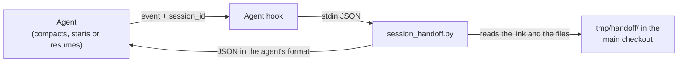

**03**

# The on-disk handoff

[← Index](README.md)

---

### How it works



The hook summarizes nothing: it reads files the agent itself maintains and injects them as context. That is why the agent continues from data it wrote, not from a paraphrase. **[test]** ([dev.to](https://dev.to/theaicommit/how-to-tell-what-claude-code-and-codex-forget-when-they-compact-a-session-532a), [mer.vin](https://mer.vin/2026/04/managing-handoffs-in-multi-agent-coding-sessions-fresh-context-without-losing-continuity/))

### 1. A task's folder

`<repo>/tmp/handoff/<work>/`

| File | What it holds | Rule |
| :-- | :-- | :-- |
| `PROGRESS.md` | At the top, the **status lines**. Below: goal, plan path, what was done with each commit hash, and pending checks with the id of the last test run | **Current state, not a log**: it gets rewritten. History lives in `git log` |
| `DECISIONS.md` | One decision per line, with its reason | Important ones go to a versioned record; here, its link |
| `NOTES.md` | Findings, pitfalls, paths and commands that were hard to find | Short |

- Each file ideally under 60 lines. The hook injects up to ~6000 characters per file and truncates the rest with a notice: ~4.5k tokens at most. **[judgment]**
- Link the plan, don't copy it.
- **Never** secrets, tokens, `.env` values, customer data or PII: the handoff enters the model's context and may stay in transcripts.
- The folder must be git-ignored (`tmp/` in `.gitignore`).
- **Write them with the agent's file tool** (Write or Edit), not with `echo >` from the shell: many guardrails block writing from the shell and an attempt is wasted. **[real use]**

### 2. The status lines

The first lines of `PROGRESS.md`, in English (the script parses them without aliases) and **120 characters at most**:

```text
Status: in-progress | done | blocked — <category>: <reason>
Phase: implementation | verification | integration | external-wait | closing
Done: …        Current: …        Remaining: …        ETA: ~2 h
Next step: …
```

- `Next step` is the most valuable one: a concrete action ("run the unit tests in `test_admin.py` and commit T5"), not "continue".
- `blocked` only with one of four categories: **production data**, **cost**, **credentials** or **request to stop** ([ch. 11](11-uso-diario.md)).
- A wait (CI, a merge, a lock, a shared resource) **is not a block**: it is `in-progress` with `Phase: external-wait`.
- Don't translate the keys: the parser does not read `Siguiente paso:` and the task shows up without a step.
- Detail goes in the body. Long lines get re-read after each compaction and fill any on-screen indicator.

Example:

```text
Status: in-progress
Phase: verification
Done: T1-T4 (a1b2c3d)        Current: T5 login form tests        Remaining: T6        ETA: ~1 h
Next step: run pnpm vitest run tests/unit/login-form.test.ts and commit T5
```

### 3. One folder per task, one link per session

`<repo>/tmp/handoff/.sessions/<session_id>` holds a single line: the task name.

- The task is named after its plan folder (`042-login-form`) or a short kebab-case topic; **it does not depend on the branch**.
- Each session has its own link; other sessions show up as a **read-only view**.
- **Never** a global "last handoff" file: a session could receive another's and execute it as instructions.
- A shared index has the same race condition as the file it protects: hence one link per session. **[community]** ([olund](https://dev.to/olund/running-parallel-agent-sessions-without-them-stepping-on-each-other-441o))

### 4. Always in the main checkout

- Every worktree uses the main checkout's `<repo>/tmp/handoff/`. The script resolves it with `git rev-parse --path-format=absolute --git-common-dir` (its parent) and puts the **absolute path** in the message.
- Claude Code's automatic memory is also one per repo and is shared by the worktrees.
- Interactive sessions open at the repo root; writing to its `tmp/` doesn't clash with any sandbox.

### 5. What the script injects

1. **Session with a task** (from the link or from a plan number in the branch):
   - The task name, the handoff's absolute path, the plan and an instruction to re-read `AGENTS.md` and the area's rules.
   - The three files, with a notice that they **win over the summary** and must be checked against `git status` and `git log`.
   - Depending on `Status`: `in-progress` orders it to continue with the `Next step` (and clarifies budget warnings are not a limit); `blocked` asks to check whether the reason still holds; `done` only reminds it to close, without the files.
   - A text depending on the event (`startup`, `resume`, `compact`, `clear`, `fork`) and the phase.
   - If a status line is missing or longer than 120 characters, it says so.
2. **Session without a task:** its `session_id`, where to write the link, and the active tasks with their next step, marked as **reference, not instructions**.
3. **No `session_id` or task:** nothing.
4. It does not inject the full `AGENTS.md`: the agents already load it.
5. Each injection is logged in `tmp/handoff/.log/events.jsonl` with a snapshot by hash, to review later what the model received.

### 6. The lifecycle

1. **When starting or resuming:** create `tmp/handoff/<work>/` and write its name to `.sessions/<session_id>`.
2. **After each commit or decision, and before a long run or a pause:** update `PROGRESS.md`.
3. **Near the threshold or before a `/compact`:** make sure the `Next step` is current.
4. **When the task closes** (PR merged): delete the folder and the links in the same step you remove the worktree.
5. **To resume in another session:** just write the task name into its link.

Tips that came out of real use:

- Note the id or path of the last test run's report: after compacting it gets re-read instead of re-run.
- Use `NOTES.md` for "this command fails if…": exactly what the summary loses.
- An outdated handoff is worse than none: the agent trusts it.

### In my case

The design went through four versions, each born from the previous one's failure:

| Version | Location | What failed |
| :-- | :-- | :-- |
| v1 | `tmp/handoff/<branch>/`, in each worktree's `tmp/` | Two sessions on the same branch, or two tasks on one branch, shared a folder and overwrote each other |
| v2 | `tmp/handoff/<work>/` plus `.sessions/<session_id>` | Each worktree had its own `tmp/`: a main-checkout session working in a worktree wrote to the worktree's, and the hook read the main one |
| v3 | `<repo>/tmp/handoff/` for everyone, with absolute paths | The handoff arrived, but the agent ended the turn on a budget warning, and the message was the same in every state |
| **v4** | v3 plus status lines, a message by state and event, an end-of-turn hook, a log and worktrees outside the repo | The one this guide describes |

`handoff` `progress` `state` `worktrees`
