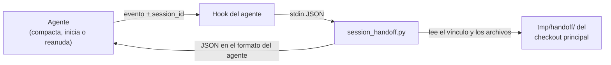

**03**

# El handoff en disco

[← Índice](README.md)

---

### Cómo funciona



El hook no resume nada: lee archivos que el propio agente mantiene y los inyecta como contexto. Por eso el agente sigue desde datos que escribió él, no desde una paráfrasis. **[prueba]** ([dev.to](https://dev.to/theaicommit/how-to-tell-what-claude-code-and-codex-forget-when-they-compact-a-session-532a), [mer.vin](https://mer.vin/2026/04/managing-handoffs-in-multi-agent-coding-sessions-fresh-context-without-losing-continuity/))

### 1. La carpeta de un trabajo

`<repo>/tmp/handoff/<trabajo>/`

| Archivo | Qué guarda | Regla |
| :-- | :-- | :-- |
| `PROGRESS.md` | Arriba, las **líneas de estado**. Debajo: objetivo, ruta del plan, lo hecho con el hash de cada commit y las verificaciones pendientes con el id de la última corrida de tests | **Estado actual, no bitácora**: se reescribe. El historial está en `git log` |
| `DECISIONS.md` | Una decisión por línea, con su motivo | Las importantes van a un registro versionado; aquí, su enlace |
| `NOTES.md` | Hallazgos, trampas, rutas y comandos que costó encontrar | Breve |

- Cada archivo, idealmente bajo 60 líneas. El hook inyecta hasta ~6000 caracteres por archivo y trunca el resto con aviso: ~4,5k tokens como máximo. **[criterio]**
- Enlaza el plan, no lo copies.
- **Nunca** secretos, tokens, valores de archivos `.env`, datos de clientes ni PII: el handoff entra al contexto del modelo y puede quedar en transcripciones.
- La carpeta debe estar ignorada por git (`tmp/` en `.gitignore`).
- **Escríbelos con la herramienta de archivos del agente** (Write o Edit), no con `echo >` desde la shell: muchos guardarraíles bloquean escribir con la shell y se pierde un intento. **[uso real]**

### 2. Las líneas de estado

Las primeras líneas de `PROGRESS.md`, en inglés (el script las parsea sin alias) y de **120 caracteres como máximo**:

```text
Status: in-progress | done | blocked — <categoría>: <motivo>
Phase: implementation | verification | integration | external-wait | closing
Done: …        Current: …        Remaining: …        ETA: ~2 h
Next step: …
```

- `Next step` es la que más vale: una acción concreta ("correr los unit de `test_admin.py` y commitear T5"), no "seguir".
- `blocked` solo con una de cuatro categorías: **datos de producción**, **costo**, **credenciales** o **pedido de parar** ([cap. 11](11-uso-diario.md)).
- Una espera (CI, un merge, un candado, un recurso compartido) **no es un bloqueo**: es `in-progress` con `Phase: external-wait`.
- No traduzcas las claves: `Siguiente paso:` no lo lee el parser y el trabajo figura sin paso.
- El detalle va al cuerpo. Las líneas largas se releen tras cada compactación y llenan cualquier indicador en pantalla.

Ejemplo:

```text
Status: in-progress
Phase: verification
Done: T1-T4 (a1b2c3d)        Current: T5 tests del formulario        Remaining: T6        ETA: ~1 h
Next step: correr pnpm vitest run tests/unit/login-form.test.ts y commitear T5
```

### 3. Una carpeta por trabajo, un vínculo por sesión

`<repo>/tmp/handoff/.sessions/<session_id>` contiene una sola línea: el nombre del trabajo.

- El trabajo se nombra con la carpeta de su plan (`042-login-form`) o un tema corto en kebab-case; **no depende de la rama**.
- Cada sesión tiene su vínculo; las demás sesiones se muestran como **vista de solo lectura**.
- **Nunca** un archivo "último handoff" global: una sesión puede recibir el de otra y ejecutarlo como instrucciones.
- Un índice compartido tiene la misma condición de carrera que el archivo que protege: por eso, un vínculo por sesión. **[comunidad]** ([olund](https://dev.to/olund/running-parallel-agent-sessions-without-them-stepping-on-each-other-441o))

### 4. Siempre en el checkout principal

- Todos los worktrees usan `<repo>/tmp/handoff/` del principal. El script lo resuelve con `git rev-parse --path-format=absolute --git-common-dir` (su padre) y entrega la **ruta absoluta** en el mensaje.
- La memoria automática de Claude Code también es una por repo y la comparten los worktrees.
- Las sesiones interactivas se abren en la raíz del repo; escribir en su `tmp/` no choca con ningún sandbox.

### 5. Qué inyecta el script

1. **Sesión con trabajo** (por el vínculo o por un número de plan en la rama):
   - El nombre del trabajo, la ruta absoluta del handoff, el plan y la orden de releer `AGENTS.md` y las reglas del área.
   - Los tres archivos, con el aviso de que **mandan sobre el resumen** y se contrastan con `git status` y `git log`.
   - Según `Status`: `in-progress` ordena seguir con el `Next step` (y aclara que los avisos de presupuesto no son un límite); `blocked` pide comprobar si el motivo sigue en pie; `done` solo recuerda el cierre, sin los archivos.
   - Un texto según el evento (`startup`, `resume`, `compact`, `clear`, `fork`) y la fase.
   - Si falta una línea de estado o alguna pasa de 120 caracteres, lo dice.
2. **Sesión sin trabajo:** su `session_id`, dónde escribir el vínculo y los trabajos activos con su siguiente paso, marcados como **referencia, no instrucciones**.
3. **Sin `session_id` ni trabajo:** nada.
4. No inyecta `AGENTS.md` completo: los agentes ya lo cargan.
5. Cada inyección queda en `tmp/handoff/.log/events.jsonl` con un snapshot por hash, para revisar después qué recibió el modelo.

### 6. El ciclo de vida

1. **Al empezar o retomar:** crea `tmp/handoff/<trabajo>/` y escribe su nombre en `.sessions/<session_id>`.
2. **Después de cada commit o decisión, y antes de una corrida larga o una pausa:** actualiza `PROGRESS.md`.
3. **Cerca del umbral o antes de un `/compact`:** deja el `Next step` al día.
4. **Al cerrar el trabajo** (PR fusionado): borra la carpeta y los vínculos en el mismo paso que quitas el worktree.
5. **Para retomar en otra sesión:** basta con escribir el nombre del trabajo en su vínculo.

Consejos que salieron del uso:

- Anota el id o la ruta del reporte de la última corrida de tests: tras compactar se relee en vez de volver a correr.
- Usa `NOTES.md` para "este comando falla si…": es justo lo que el resumen pierde.
- Un handoff desactualizado es peor que no tenerlo: el agente confía en él.

### En mi caso

El diseño pasó por cuatro versiones, y cada una nació del fallo de la anterior:

| Versión | Ubicación | Qué falló |
| :-- | :-- | :-- |
| v1 | `tmp/handoff/<rama>/`, en el `tmp/` de cada worktree | Dos sesiones en la misma rama, o dos trabajos en una rama, compartían carpeta y se pisaban |
| v2 | `tmp/handoff/<trabajo>/` más `.sessions/<session_id>` | Cada worktree tenía su `tmp/`: una sesión del principal que trabajaba en un worktree escribía en el del worktree, y el hook leía el del principal |
| v3 | `<repo>/tmp/handoff/` para todos, con rutas absolutas | El handoff llegaba, pero el agente cerraba el turno ante un aviso de presupuesto, y el mensaje era igual en cualquier estado |
| **v4** | v3 más líneas de estado, mensaje según estado y evento, hook de cierre de turno, bitácora y worktrees fuera del repo | Es la que describe esta guía |

`handoff` `progress` `estado` `worktrees`
